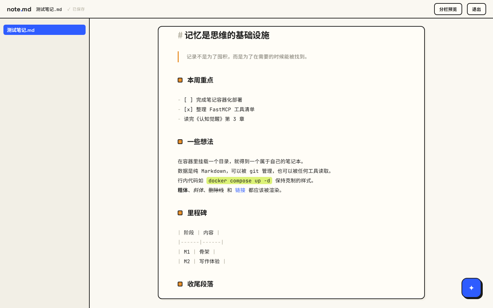
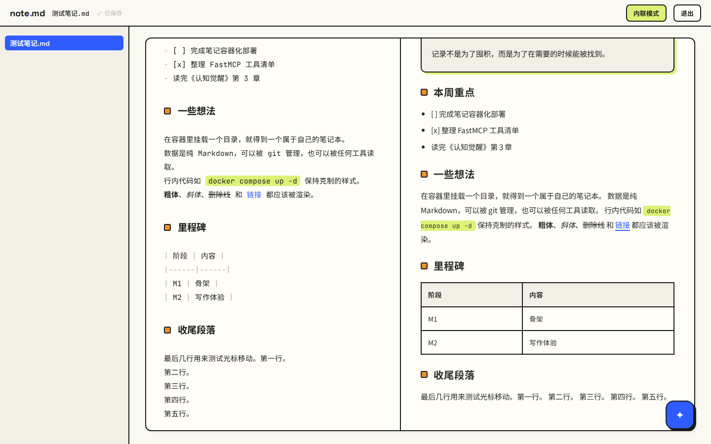

# note.md — 容器里的 AI 原生 Markdown 笔记本

挂载一个目录就是你的笔记本：纯 `.md` 文件、浏览器即时读写，内置 AI 助手帮你查找与整理笔记（FastAPI + FastMCP + assistant-ui + CodeMirror）。

## 效果预览

**内联编辑**——边写边渲染，光标处展开 Markdown 源码：



**分栏预览**——左源码右渲染，同步滚动：



## 功能
- 目录树浏览、新建 / 重命名 / 删除（删除进回收站 `.trash/`），只管理 Markdown 文件
- 边写边渲染的内联编辑，一键切换分栏预览；自动保存、防冲突覆盖
- 悬浮 AI 助手（⌘J）：对话式全文搜索、整理目录、批量改写，写操作按会话授权
- MCP Server 内置：外部 AI 客户端（Cursor / Claude Desktop 等）可直接接入操作笔记本
- 单口令登录换 token，全部接口受保护

## 快速开始（Docker，推荐）

```bash
docker run -d --name note-md -p 8080:8080 \
  -v $PWD/notes:/notes \
  -e NOTE_MD_PASSWORD=change-me \
  -e OPENAI_BASE_URL=https://your-llm-gateway/v1 \
  -e OPENAI_API_KEY=sk-... \
  -e OPENAI_MODEL=qwen-plus \
  ghcr.io/zunley/note.md:latest
```

浏览器打开 `http://<host>:8080/` 即可使用。`./notes/` 即笔记本根目录，随时可拷走。
镜像由 CI 多架构（amd64/arm64）释出，仓库内另附 `compose.yaml` 便于携带完整配置。

## 环境变量

| 变量 | 默认 | 说明 |
|------|------|------|
| `NOTE_MD_PASSWORD` | —（必填） | 登录口令 |
| `NOTE_MD_TOKEN_TTL` | `72h` | 登录有效期 |
| `NOTE_MD_ROOT` | `/notes` | 笔记本根目录（容器内） |
| `OPENAI_BASE_URL` | — | OpenAI 兼容接口地址 |
| `OPENAI_API_KEY` | — | LLM 密钥（仅存服务端） |
| `OPENAI_MODEL` | — | 模型名 |
| `NOTE_MD_AI_AUTO_WRITE` | 关闭 | AI 免确认写文件 |
| `NOTE_MD_PORT` | `8080` | 对外映射端口（compose） |

## 外部 AI 客户端接入（MCP）

MCP 端点：`http://<host>:8080/mcp`（streamable-http，Bearer token 鉴权）。

以 Claude Desktop / Cursor 的 MCP 配置为例：

```json
{
  "mcpServers": {
    "note-md": {
      "type": "streamable-http",
      "url": "http://<host>:8080/mcp",
      "headers": { "Authorization": "Bearer <登录后获取的 token>" }
    }
  }
}
```

token 通过登录接口获取：`curl -X POST http://<host>:8080/api/auth/login -d '{"password":"<口令>"}'`。
工具清单：`list_tree` `read_file` `search_files` `list_backlinks` `get_outline` `create_file` `write_file` `append_file` `move_file` `delete_file` `list_sessions` `read_session`。

## 文档
- 产品定义与设计：[docs/PRODUCT.md](docs/PRODUCT.md)
- 开发说明与实现备注：[docs/DEV.md](docs/DEV.md)
- 样式定稿：[docs/style/](docs/style/README.md)
